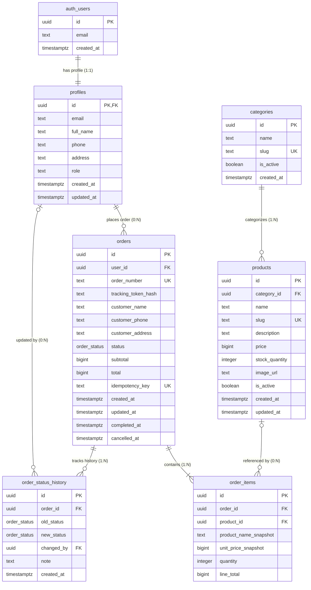
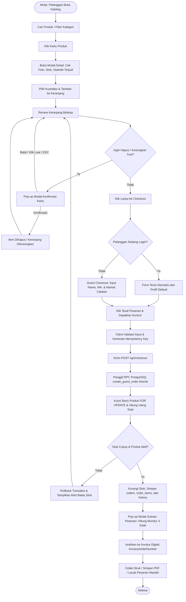
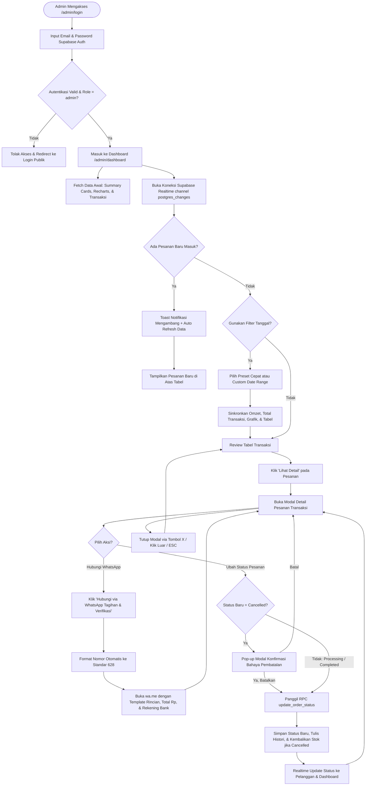
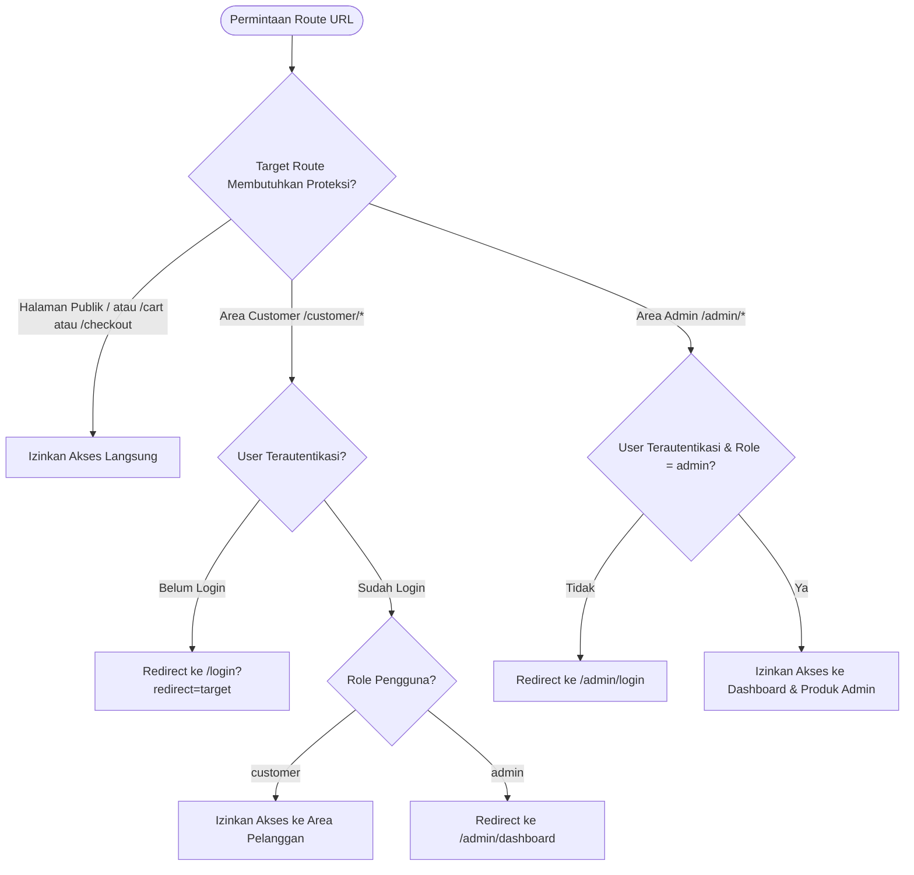

# ERD & Flowchart — AmaraStore (Mini E-Commerce & Real-time Order Management)

Dokumen ini memetakan arsitektur basis data relasional (ERD) dan alur kerja (*flowcharts*) yang merefleksikan implementasi sistem **AmaraStore** secara presisi.

---

## 1. Entity Relationship Diagram (ERD)

Diagram di bawah ini menggambarkan struktur tabel pada database PostgreSQL (Supabase) yang digunakan oleh aplikasi:

### Penjelasan Entitas & Integritas Data

1. **`auth.users` & `profiles` (1:1)**:
   - Setiap pengguna yang mendaftar di Supabase Auth otomatis memiliki record di tabel `profiles`.
   - Kolom `role` bernilai `'admin'` (untuk pengelola toko) atau `'customer'` (untuk pelanggan terdaftar).
   - Profil pelanggan menyimpan alamat default (`address`) dan kontak telepon (`phone`) untuk kemudahan checkout otomatis (*auto-fill*).

2. **`categories` & `products` (1:N)**:
   - Kategori mengelompokkan produk di katalog.
   - `products.category_id` bersifat opsional (*nullable*); produk tetap valid jika belum dikategorikan.
   - `stock_quantity` bernilai integer positif yang dicek dan dikurangi secara otomatis setiap transaksi berhasil.

3. **`orders` & `order_items` (1:N)**:
   - `orders.user_id` bernilai *nullable*: diisi `uuid` pelanggan jika pembeli melakukan checkout dalam keadaan login, atau `NULL` jika pembeli menggunakan mode **Guest Checkout**.
   - `orders.order_number`: Kode unik pesanan yang ramah dibaca (format: `ORD-YYYYMMDD-XXXXXXXX`) dibuat oleh database.
   - Snapshot Harga & Nama (`product_name_snapshot` & `unit_price_snapshot`): Mengabadikan data saat pesanan dibuat, sehingga jika nama atau harga produk diubah oleh admin di masa depan, faktur invoice lama tidak akan berubah.
   - Nominal uang (`price`, `subtotal`, `total`, `line_total`) disimpan dalam satuan Rupiah bulat (`bigint`).
   - `idempotency_key` mencegah terjadinya duplikasi pesanan jika tombol checkout ditekan berulang.

4. **`order_status_history`**:
   - Mencatat audit trail setiap kali status pesanan berubah dari `old_status` ke `new_status` beserta waktu dan catatan.

---

## 2. Flowchart A — Alur Belanja Pelanggan (Guest & Customer) hingga Invoice

Diagram alur berikut memperlihatkan perjalanan pengguna dari membuka katalog produk hingga mendapatkan invoice digital dan pelacakan pesanan:

---

## 3. Flowchart B — Admin Real-Time Dashboard, Filter Tanggal & Tagihan WhatsApp

Diagram berikut memetakan operasional toko di panel admin, mulai dari analitik data hingga komunikasi WhatsApp ke pelanggan:

---

## 4. Flowchart C — Proteksi Route Berdasarkan Peran (Role Guard)

Diagram berikut menjelaskan isolasi akses ketat antara Admin, Customer terdaftar, dan Pengunjung publik:

