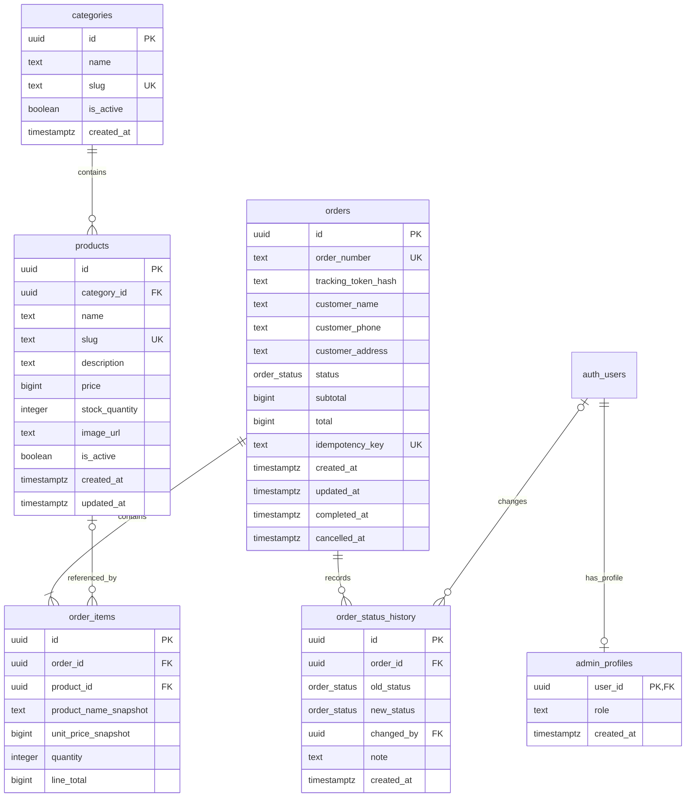
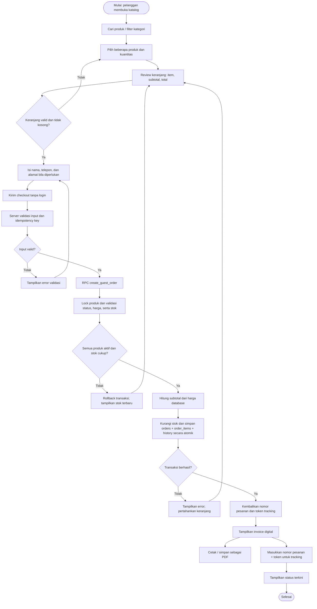
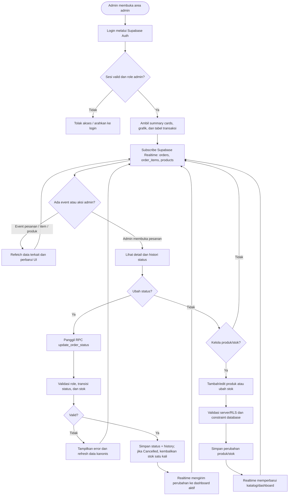

# ERD & Flowchart — Mini E-Commerce (Quick Order)

Dokumen ini mengikuti entitas dan alur utama pada PRD Mini E-Commerce (Quick Order) & Real-time Admin Dashboard.

## 1. Entity Relationship Diagram (ERD)

### Penjelasan ERD

- `categories` memiliki banyak `products`; produk boleh tidak memiliki kategori (`category_id` nullable).
- `admin_profiles.user_id` mereferensikan `auth.users.id` milik Supabase Auth. Entitas `auth_users` pada diagram adalah tabel bawaan Supabase `auth.users`, bukan tabel aplikasi ketujuh.
- `orders` menyimpan data transaksi dan snapshot subtotal/total. `order_number` dibuat unik oleh database.
- `order_items` menyimpan detail setiap produk dalam pesanan. Nama dan harga disalin ke kolom snapshot agar invoice lama tidak berubah saat data produk berubah. `product_id` nullable agar histori tetap ada jika produk dihapus di masa depan.
- `order_status_history` mencatat perubahan status, waktu, admin yang melakukan perubahan (jika ada), dan catatan.
- `idempotency_key` opsional mencegah permintaan checkout yang sama membuat pesanan ganda. Nominal uang disimpan sebagai `bigint` dalam rupiah utuh.

## 2. Flowchart A — Guest Checkout Multi-Produk hingga Invoice & Tracking

### Penjelasan Flowchart A

Pelanggan memilih satu atau lebih produk, lalu mengirim checkout tanpa akun. Server tidak mempercayai harga atau total dari browser; RPC mengambil harga dan stok dari PostgreSQL, mengunci baris produk, menghitung total, dan menyimpan pesanan beserta item serta histori status dalam satu transaksi. Jika satu item tidak valid atau stok tidak cukup, seluruh transaksi dibatalkan sehingga stok dan pesanan tetap konsisten. Setelah sukses, pelanggan menerima nomor pesanan dan token pelacakan; token dibutuhkan agar nomor pesanan saja tidak menjadi satu-satunya kontrol akses.

## 3. Flowchart B — Admin Real-time Dashboard & Manajemen Status/Stok

### Penjelasan Flowchart B

Admin harus memiliki sesi Supabase Auth yang valid dan role `admin`. Dashboard memuat statistik, grafik, dan transaksi, lalu berlangganan event Realtime yang diperlukan. Ketika status pesanan diubah, RPC memvalidasi hak admin dan transisi status, menulis histori, serta mengembalikan stok satu kali jika pesanan dibatalkan. Operasi produk/stok tetap dibatasi RLS dan constraint database. Setelah reconnect Realtime, aplikasi sebaiknya melakukan refetch agar UI kembali sinkron dengan database.
